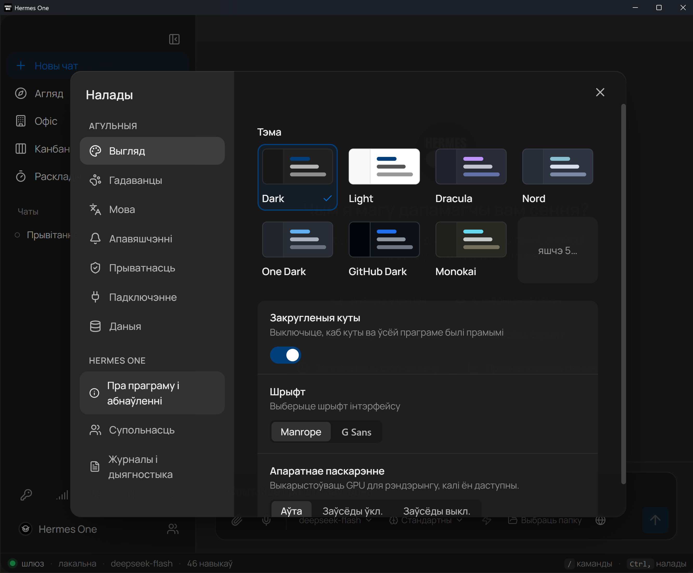

# Hermes One Desktop — беларуская мова


Неафіцыйная беларуская лакалізацыя **Hermes One Desktop**
([fathah/hermes-desktop](https://github.com/fathah/hermes-desktop), MIT):
24 прасторы імёнаў, каля 1 800 радкоў інтэрфэйсу, а таксама радкі, якія не ішлі
праз i18n — карткі інструментаў і платформ, слаш-каманды, загалоўкі катэгорый,
натыўныя меню, дыялогі ўсталёўшчыка і шлюза, падпісы рэестра.

- **Pull Request ва upstream:** https://github.com/fathah/hermes-desktop/pull/1104
- **Код лакаля:** https://github.com/yurashet/hermes-desktop/tree/feat/belarusian-locale

## Скрыншоты

| Галоўны экран | Налады |
|---|---|
|  |  |

## Як паставіць

### Варыянт 1. Гатовы патч для ўсталяванай Hermes One Desktop 0.7.9 (хутка)

1. Усталюйце **Hermes One Desktop 0.7.9** —
   [releases upstream](https://github.com/fathah/hermes-desktop/releases).
2. Спампуйце з раздзела **Releases** гэтага рэпазіторыя два файлы:
   `app.asar` (каля 215 МБ) і `install-be.ps1`.
3. Пакладзіце іх у адну папку і запусціце PowerShell:

   ```powershell
   powershell -ExecutionPolicy Bypass -File .\install-be.ps1
   ```

   Скрыпт знойдзе ўсталяваную праграму, зробіць рэзервовую копію
   `app.asar.backup` і падменіць архіў.

   > Калі Windows пазначыў спампаваны скрыпт як заблакаваны, спачатку
   > выканайце `Unblock-File .\install-be.ps1` (або ПКМ → Уласцівасці →
   > «Разблакаваць»).
4. Запусціце Hermes One → **Налады → Мова → Беларуская**.

> Патч прызначаны толькі для версіі **0.7.9**. Пасля абнаўлення праграмы
> мову трэба паўтарыць або паставіць з зыходнікаў (варыянт 2).

### Варыянт 2. З зыходнікаў (для любой версіі)

```bash
git clone -b feat/belarusian-locale https://github.com/yurashet/hermes-desktop.git
cd hermes-desktop
npm ci
npm run dev
```

У праграме выберыце **Налады → Мова → Беларуская**.

## Адкат

Скрыпт захоўвае арыгінальны архіў як `app.asar.backup` побач з усталяваным.
Каб вярнуць англійскую мову (пры закрытай праграме):

```powershell
Copy-Item "$env:LOCALAPPDATA\Programs\hermes-desktop\resources\app.asar.backup" "$env:LOCALAPPDATA\Programs\hermes-desktop\resources\app.asar" -Force
```

## Што перакладзена

- Увесь інтэрфэйс: 24 прасторы імёнаў (агульныя радкі, чат, налады, правайдэры,
  мадэлі, шлюз, расклады, канбан, памяць, навыкі, усталяванне і інш.).
- Радкі па-за i18n: карткі і апісанні інструментаў і платформ, слаш-каманды і
  загалоўкі катэгорый, натыўнае і кантэкстнае меню, дыялогі ўсталёўшчыка,
  аднаўлення з рэзервовай копіі і запыту пароля, падпісы рэестра.
- Наўмысна **не** перакладаюцца: назвы прадуктаў і кампаній, ID мадэляў,
  тэхнічныя токены (API, URL, JSON, MCP, SSH, cron) і назвы тэмаў афармлення.

## Якасць

- Валідатар лакаля: **0** цвёрдых памылак (ключы і парадак супадаюць з `en/`,
  плейсхолдары цэлыя, няма русізмаў і ўкраінскіх літар).
- Вычытка моцнай мадэллю (Claude Sonnet 4.5 праз OpenRouter), 3 раўнды,
  плюс асобны праход крытыка.
- `npm run typecheck` — чыста; мэтавыя тэсты (i18n, StatusBar, Gateway,
  Providers, WebPreview) — зялёныя.

## Ліцэнзія

Арыгінальная праграма распаўсюджваецца пад MIT — гл. [LICENSE](LICENSE).
Гэты рэпазіторый — неафіцыйная лакалізацыя і не звязаны з аўтарамі Hermes One.
Падрабязнасці — у [NOTICE.md](NOTICE.md).
