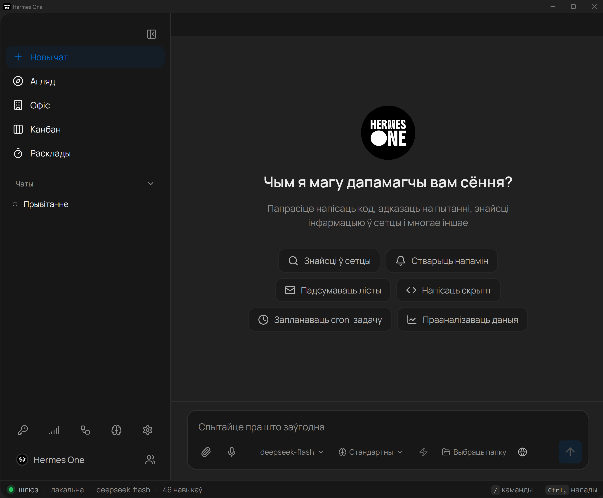

# Hermes One Desktop — беларуская мова



Неафіцыйная беларуская лакалізацыя **Hermes One Desktop**
([fathah/hermes-desktop](https://github.com/fathah/hermes-desktop), MIT):
24 прасторы імёнаў, каля 1 800 радкоў інтэрфэйсу, а таксама радкі, якія не ішлі
праз i18n — карткі інструментаў і платформ, слаш-каманды, загалоўкі катэгорый,
натыўныя меню, дыялогі ўсталёўшчыка і шлюза, падпісы рэестра.

- **Pull Request ва upstream:** https://github.com/fathah/hermes-desktop/pull/1104
- **Код лакаля:** https://github.com/yurashet/hermes-desktop/tree/feat/belarusian-locale

## Скрыншоты

| Галоўны экран | Налады |
|---|---|
|  |  |

## Як паставіць

### Варыянт 1. Гатовы патч для ўсталяванай Hermes One Desktop 0.7.9 (хутка)

1. Усталюйце **Hermes One Desktop 0.7.9** —
   [releases upstream](https://github.com/fathah/hermes-desktop/releases).
2. Спампуйце з раздзела **Releases** гэтага рэпазіторыя два файлы:
   `app.asar` (каля 215 МБ) і `install-be.ps1`.
3. Пакладзіце іх у адну папку і запусціце PowerShell:

   ```powershell
   powershell -ExecutionPolicy Bypass -File .\install-be.ps1
   ```

   Скрыпт праверыць версію (патрэбна 0.7.9), пачакае, пакуль вы цалкам
   закрыеце Hermes One, зробіць рэзервовыя копіі `app.asar.backup` і
   `desktop.json.backup`, падменіць архіў, паставіць `locale: be` і
   запусціць праграму зноў — ужо па-беларуску.

   Каб скрыпт сам закрыў праграму (без чакання), дадайце `-Force`:

   ```powershell
   powershell -ExecutionPolicy Bypass -File .\install-be.ps1 -Force
   ```

   > Калі Windows пазначыў спампаваны скрыпт як заблакаваны, спачатку
   > выканайце `Unblock-File .\install-be.ps1` (або ПКМ → Уласцівасці →
   > «Разблакаваць»).
4. Пасля перазапуску праверце: **Налады → Мова → Беларуская**.

> Патч прызначаны толькі для версіі **0.7.9**. Пасля абнаўлення праграмы
> мову трэба паўтарыць або паставіць з зыходнікаў (варыянт 2).

### Варыянт 2. З зыходнікаў (для любой версіі)

```bash
git clone -b feat/belarusian-locale https://github.com/yurashet/hermes-desktop.git
cd hermes-desktop
npm ci
npm run dev
```

У праграме выберыце **Налады → Мова → Беларуская**.

## Промт для Гермеса (перадаць калегу)

Калега можа проста ўставіць гэты тэкст у свайго Гермеса — той сам праверыць
версію і падрыхтуе ўсталёўку:

```text
Ты — AI-агент Hermes. Дапамажы ўсталяваць неафіцыйную беларускую лакалізацыю
Hermes One Desktop. Працуй па кроках, нічога не выдаляй і не чапай іншыя ўсталёўкі.

КРОК 1. Вызнач АС і версію.
- Калі АС не Windows — спыніся і дай спасылку:
  https://github.com/yurashet/hermes-belarusian (там зборка з зыходнікаў).
- Знайдзі hermes-agent.exe у:
  %LOCALAPPDATA%\Programs\hermes-desktop\
  %ProgramFiles%\hermes-desktop\
- Прачытай версію: (Get-Item $exe).VersionInfo.FileVersion

КРОК 2. Правер версію.
- Калі версія НЕ пачынаецца з "0.7.9": нічога не спампоўвай і не мяняй. Скажы:
  «Гатовы патч падтрымлівае толькі 0.7.9. Абнавіцеся да 0.7.9:
   https://github.com/fathah/hermes-desktop/releases/tag/v0.7.9
   і запусціце гэты промт зноў. Або зборка з зыходнікаў:
   https://github.com/yurashet/hermes-belarusian»
  Спыніся.
- Калі версія 0.7.9 — працягвай.

КРОК 3. Падрыхтуй файлы.
- Ствары папку %USERPROFILE%\Downloads\hermes-be.
- Спампуй туды (curl.exe або Invoke-WebRequest):
  https://github.com/yurashet/hermes-belarusian/releases/download/v0.7.9-be.1/app.asar
  https://github.com/yurashet/hermes-belarusian/releases/download/v0.7.9-be.1/install-be.ps1
- Правер SHA256 файла app.asar (Get-FileHash -Algorithm SHA256). Чакаецца:
  b9084b4362feaced9df41c9bcb414d8c76087796734a4de39688d816f44d8371
  Калі не супала — спыніся, нічога не запускай і дай спасылку на ручную ўсталёўку.

КРОК 4. Ствары побач файл run-be.cmd з такім змесцівам:
  @echo off
  powershell -NoProfile -ExecutionPolicy Bypass -File "%~dp0install-be.ps1"
  pause

КРОК 5. Скажы карыстальніку:
«Файлы гатовыя. Цалкам зачыніце Hermes One (разам з іконкай у трэі) і двойчы
пстрыкніце run-be.cmd у папцы Downloads\hermes-be. Скрыпт сам зробіць рэзервовыя
копіі, заменіць app.asar, паставіць locale=be і перазапусціць Hermes — ён
адкрыецца па-беларуску. Калі скрыпт паведаміць, што Hermes яшчэ запушчаны, проста
зачыніце яго: скрыпт пачакае. Праверка: Налады → Мова → Беларуская.»

АБМЕЖАВАННІ:
- Не выдаляй файлы, не выводзь сакрэты, не выкарыстоўвай -Force без яўнай просьбы.
- Калі няма інтэрнэту, няма правоў або хэш не супаў — нічога не мяняй, дай спасылку
  https://github.com/yurashet/hermes-belarusian і ручныя крокі адтуль.
```

## Адкат

Скрыпт захоўвае арыгінальныя файлы як `app.asar.backup` і
`desktop.json.backup`. Каб вярнуць англійскую мову (пры закрытай праграме):

```powershell
Copy-Item "$env:LOCALAPPDATA\Programs\hermes-desktop\resources\app.asar.backup" "$env:LOCALAPPDATA\Programs\hermes-desktop\resources\app.asar" -Force
if (Test-Path "$env:LOCALAPPDATA\hermes\desktop.json.backup") {
  Copy-Item "$env:LOCALAPPDATA\hermes\desktop.json.backup" "$env:LOCALAPPDATA\hermes\desktop.json" -Force
}
```

## Што перакладзена

- Увесь інтэрфэйс: 24 прасторы імёнаў (агульныя радкі, чат, налады, правайдэры,
  мадэлі, шлюз, расклады, канбан, памяць, навыкі, усталяванне і інш.).
- Радкі па-за i18n: карткі і апісанні інструментаў і платформ, слаш-каманды і
  загалоўкі катэгорый, натыўнае і кантэкстнае меню, дыялогі ўсталёўшчыка,
  аднаўлення з рэзервовай копіі і запыту пароля, падпісы рэестра.
- Наўмысна **не** перакладаюцца: назвы прадуктаў і кампаній, ID мадэляў,
  тэхнічныя токены (API, URL, JSON, MCP, SSH, cron) і назвы тэмаў афармлення.

## Якасць

- Валідатар лакаля: **0** цвёрдых памылак (ключы і парадак супадаюць з `en/`,
  плейсхолдары цэлыя, няма русізмаў і ўкраінскіх літар).
- Вычытка моцнай мадэллю (Claude Sonnet 4.5 праз OpenRouter), 3 раўнды,
  плюс асобны праход крытыка.
- `npm run typecheck` — чыста; мэтавыя тэсты (i18n, StatusBar, Gateway,
  Providers, WebPreview) — зялёныя.

## Ліцэнзія

Арыгінальная праграма распаўсюджваецца пад MIT — гл. [LICENSE](LICENSE).
Гэты рэпазіторый — неафіцыйная лакалізацыя і не звязаны з аўтарамі Hermes One.
Падрабязнасці — у [NOTICE.md](NOTICE.md).
